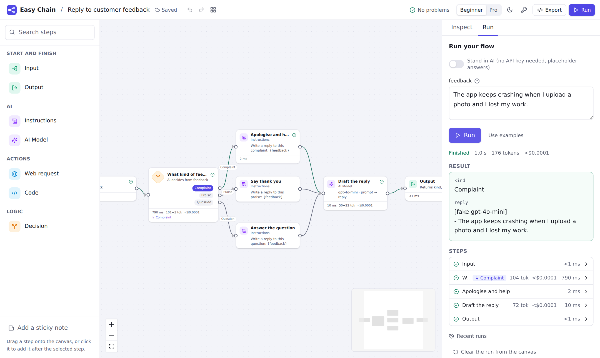
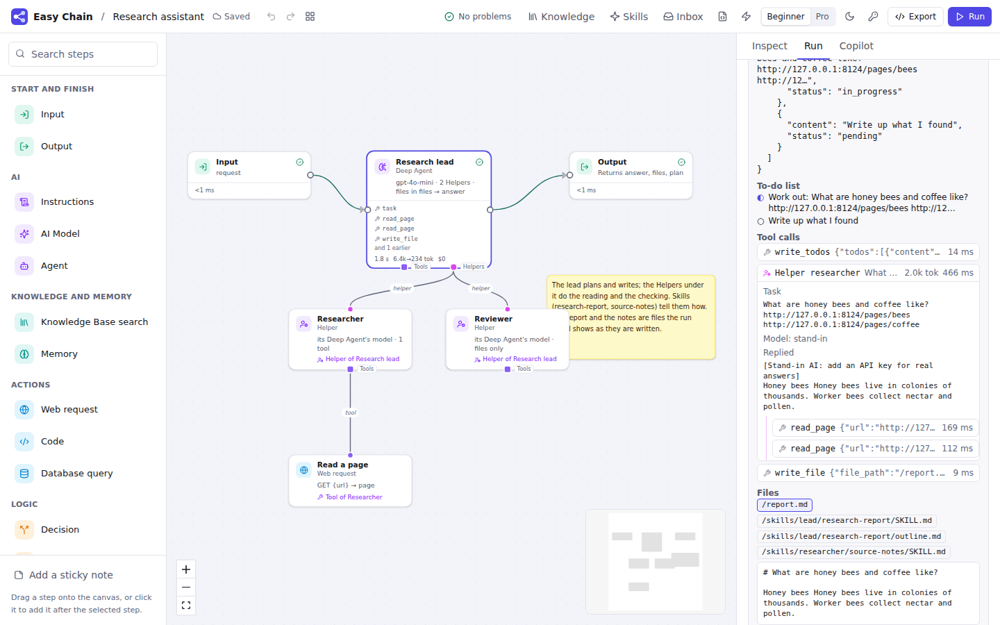
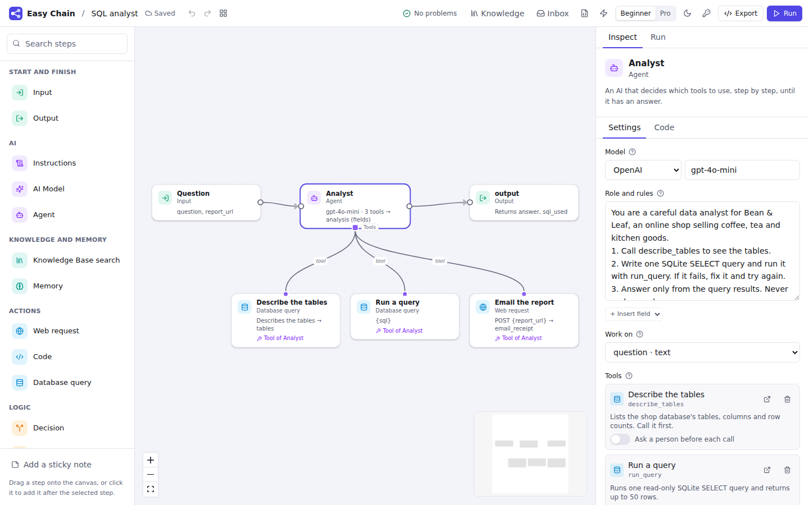
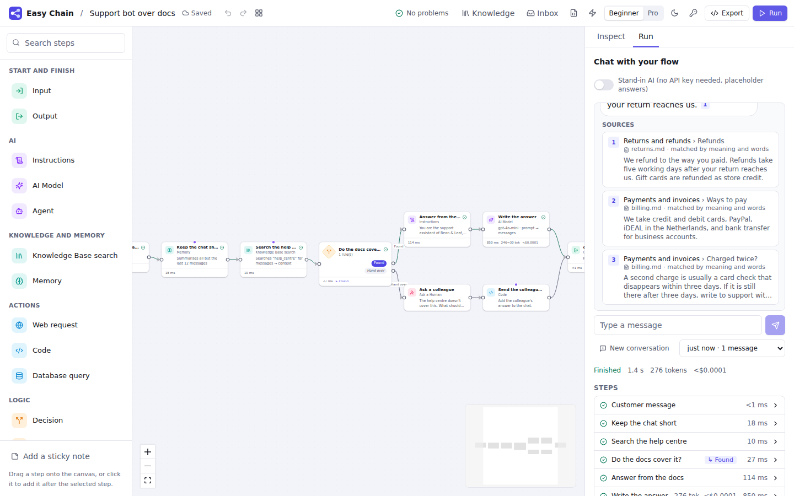
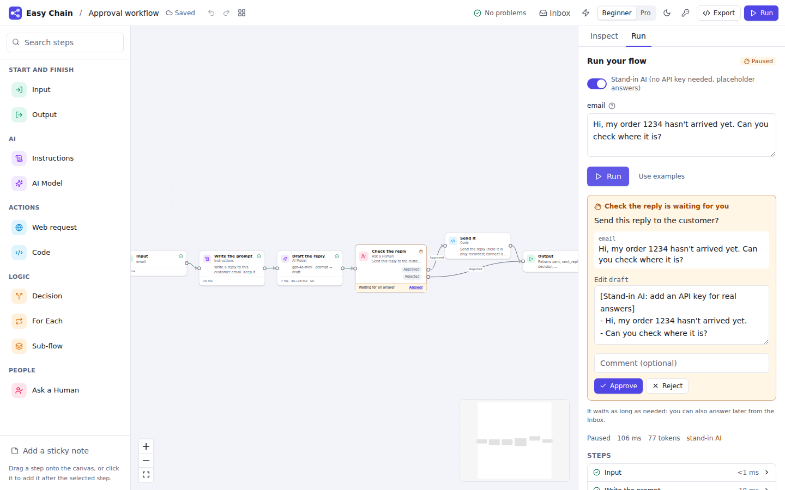

# Easy Chain

**Draw your AI app, press Run, watch it think, ship it with one click.**

Easy Chain is an open-source, drag-and-drop builder for LLM apps and AI agents, made for
low-code builders: analysts, operations and product people, consultants. It is a visual layer
on top of the real LangChain stack, not a replacement for it. Every flow compiles to plain
LangGraph code. That same code runs when you press Run and is what you get when you export,
with no Easy Chain runtime required.



> **Status: Phase 5 (Platform) in progress.** Phases 0 to 4 are done
> ([all phases in one report](docs/report.md)). Every step is marked in the
> [build tracker](#build-tracker), with known issues under [Fix later](#fix-later). Deep Agents
> plan, keep files and hand work to Helpers that follow your Skills; agent teams are made of
> ordinary steps; Code runs in a sandbox; a copilot drafts flows from a description. Phase 5 adds
> logins and roles, evaluation and publishing.

## Quick start

**With Docker (one command):**

```bash
docker compose up        # Postgres + API + a worker; open http://localhost:8000
docker compose up --scale worker=3   # more workers; stopping or killing one is safe
```

**From source** on Windows, macOS or Linux (needs [uv](https://docs.astral.sh/uv/) and
[pnpm](https://pnpm.io/), Node 20+):

```bash
pnpm run setup           # Python 3.12 environment + web dependencies
pnpm dev                 # API on :8000, web app on http://localhost:5173
```

`make install` and `make dev` do the same where `make` is installed. Windows notes are in
[docs/handover/environment.md](docs/handover/environment.md#windows).

Then pick a template and press **Try it**. No API key yet? Switch on the **stand-in AI** in the
Run panel to see the flow work with placeholder answers, or add your key under **Settings → Keys
and providers** (it is stored encrypted on your machine and never saved in flows or exports).
The *Support bot over docs*, *SQL analyst* and *Inbox triage* templates come with a sample help
centre and shop database, so they work straight away; the *Research assistant* reads the pages
you give it.

**From the command line:**

```bash
cd python
uv run easychain run ../examples/hello.flow.yaml -i question="What is LangGraph?" --stand-in
uv run easychain export ../examples/hello.flow.yaml -o hello/   # a standalone LangGraph project
uv run easychain worker --database-url postgresql://…           # a worker for a shared database
```

## What you get

### Phase 4: autopilot and teams

| | |
|---|---|
| **Deep Agent** | An agent for longer tasks (`create_deep_agent`): it plans with a to-do list, keeps notes and drafts in files, and hands sub-tasks to Helpers. The run panel shows the list and each file as they change. Files are kept with every Save Point, so they survive a crash and rewind with time travel. |
| **Helpers** | Specialists under a Deep Agent, each with its own role, model and tools. Their work nests under the task that started it in the trace, with its own tokens and cost. Approvals inside a Helper go to the Inbox. |
| **Skills** | A Skills library in the Agent Skills format (`SKILL.md` and its files): how to write a report, take notes, sort email. An agent reads a skill when its description fits the task, and the skills ship inside exports. |
| **Agent teams** | Supervisor, handoffs and plan-and-execute, made of ordinary steps (so they stay editable and export to plain LangGraph). Insert one from the step library, or start from a template. |
| **Code sandbox** | Code steps run in a locked-down Docker container per call (gVisor when installed): no host files, no network unless allowed, limits on memory, time and processes. Escape tests prove it. |
| **Copilot** | Describe a flow or a change in words. The proposal is checked before it is shown, previewed on the canvas, and you keep the changes you want: one undo step. Any model you have a key for. |
| **Templates** | *Research assistant* (a Deep Agent with a researcher and a reviewer) and *Inbox triage* (a supervisor; urgent email waits for a person), each with a 10-case Test Set. |

See [docs/steps/deep_agent.md](docs/steps/deep_agent.md), [docs/skills.md](docs/skills.md),
[docs/patterns.md](docs/patterns.md), [docs/sandbox.md](docs/sandbox.md) and
[docs/copilot.md](docs/copilot.md).



### Phase 3: agents and knowledge

| | |
|---|---|
| **Agent step** | An AI that calls tools until it has an answer (`create_agent`). Any Web request, Code, Sub-flow, Knowledge Base search, Database query, MCP tool or Memory step becomes a tool: drag it onto the agent's **Tools** handle and describe it. Tool calls show live under the agent and in the trace. |
| **Add-ons** | Agent middleware behind toggles: **ask a person before** a tool runs (approve, edit or reject in the run panel or Inbox), call limits, retries, fallback models, summarising long chats, personal data filters, tool selection, a to-do list, long-term memory. |
| **Knowledge Bases** | Upload PDF, Word, HTML, Markdown, CSV or text, or add web pages; see how they split; search by meaning, words, or both (hybrid), with optional re-ranking. Answers cite `[1]` and the run panel links each citation to its passage, page and heading. pgvector on Postgres, SQLite locally. |
| **Structured replies** | A field builder for the AI Model and Agent: text, numbers, yes/no, choices, lists, nested groups. Replies are validated, retried when they don't fit, and each field can go straight into Flow Data. |
| **Tools from everywhere** | **MCP servers** (HTTP, or approved local commands) in Settings; **Import an API** from an OpenAPI description into typed Web request steps; a **Database query** step that is read-only unless you say otherwise; a **Memory** step to remember facts about a user, or keep a long chat short. |
| **14 model providers** | OpenAI, Anthropic, Ollama, Google Gemini and Vertex AI, AWS Bedrock, Azure OpenAI, Mistral, Groq, Together, Fireworks, OpenRouter, DeepSeek and xAI, plus eight embedding model families. |

See [docs/agents.md](docs/agents.md) and [docs/knowledge.md](docs/knowledge.md).





### Phase 2: a real runtime

| | |
|---|---|
| **Durable runs** | Runs, their events and Save Points live in SQLite (local) or Postgres. A queue hands runs to workers; if a worker dies, another carries the run on from its last Save Point. Finished steps never run again, and side effects (POST requests, Code marked *run at most once*) are remembered and carry an `Idempotency-Key`, so nothing is sent twice. |
| **Ask a Human and the Inbox** | A step that pauses the run until a person approves, edits, answers or picks an option, in the run panel or the **Inbox**, a minute or a week later. Notifications by webhook, Slack or email. |
| **Loops, branches and lists** | Round limits on Decisions, **Jump** (set data and pick the next step), parallel branches that **wait for all**, **For Each** with a concurrency limit, and **Sub-flows** (a flow as a step; double-click to open it). |
| **Per-step run policy** | Retries with backoff, time limits, a cache for repeated inputs. Flow settings for max rounds, parallelism, runs at once, and what happens when a chat gets a second message while busy. |
| **Flow Data panel** | Declare fields with types and update rules: replace, add to the list, add up, merge, or a custom Python `combine(old, new)`. |
| **Debugging** | Breakpoints before or after any step, **Save Points** with the Flow Data at each one, and **run again from here** with edited values (time travel). Stop a run and carry it on later. Runs keep going if you reload the page. |
| **Triggers and the API** | Start flows from a webhook, a schedule (cron with time zones), a file upload, or when another flow finishes. Follow any run over SSE (`Last-Event-ID` resumes) or a WebSocket, and use [`@easychain/client`](packages/client) with its React hook in your own app. |

See [docs/runs.md](docs/runs.md) for how runs, workers, the Inbox, triggers and the API work.



### Phase 1: the visual builder

| | |
|---|---|
| **Canvas** | Drag steps from a searchable Step library, connect them, auto-layout, minimap, sticky notes, undo/redo, copy/paste across flows, keyboard shortcuts. Dropping a connection on empty canvas offers to add a step there. Invalid connections explain why. |
| **Inspector** | A form for every step, with tooltips and examples, **More options** for advanced settings, and a **Code** tab showing the LangGraph code each step compiles to. |
| **Checks before a run** | Missing inputs, misspelt `{variables}` ("Did you mean `{page}`?"), unreachable steps, loops with no way out, missing API keys. Each problem is pinned to a step, and many have a one-click fix. |
| **See it think** | The active step glows, tokens stream inside the AI step, data pulses along connections, Decisions highlight the exit they took, and each step shows its time, tokens and cost. Click any step in the trace to see what it read and saved. **Run Replay** plays a past run back on the canvas. |
| **Fail loudly and helpfully** | Errors appear on the step that failed, in plain words ("The web request got 404 Not Found from example.com"), with buttons such as **Add your API key** or **Try with the stand-in AI**. |
| **Chat and forms** | Chat flows get a chat panel that remembers the conversation; other flows get a form generated from their inputs. |
| **Export** | A zip with idiomatic, commented Python (`langgraph` + `langchain` only), `requirements.txt`, `langgraph.json` for `langgraph dev`, a `.env.example` listing every key, secret and connection the flow reads, and the flow file. |
| **Beginner and Pro modes** | Pro mode shows the LangChain/LangGraph term next to each name, advanced settings, step ids and Decision expressions. Light and dark themes. |

### The steps

| Easy Chain name | LangChain-stack term | What it does |
|---|---|---|
| Input | `START` + input schema | Where a run starts: form fields, or chat messages |
| Instructions | `ChatPromptTemplate` | A prompt with `{variables}` filled from Flow Data |
| AI Model | chat model via `init_chat_model` | Sends text or a prompt to a model; free text or fixed fields (`with_structured_output`) |
| Agent | `create_agent` + middleware | Calls tools (other steps, MCP servers) until it has an answer |
| Deep Agent | `create_deep_agent` (deepagents) | Plans, keeps files, follows skills and hands sub-tasks to Helpers |
| Helper | deepagents sub-agent | A specialist a Deep Agent hands tasks to, with its own role, tools and model |
| Web request | HTTP request tool | Fetches a page (as readable text) or calls an API |
| Code | Python function | `run(data)` returns the Flow Data fields to update |
| Decision | conditional edge | Picks an exit by rules, a safe expression, or by asking an AI; round limits for loops |
| For Each | `Send` (map-reduce) | Runs a step for every item of a list, side by side, and collects the results in order |
| Sub-flow | subgraph | Runs another flow as one step, with shared or mapped Flow Data |
| Jump | `Command(update, goto)` | Sets Flow Data and picks the next step in one move (Pro) |
| Ask a Human | `interrupt()` | Pauses until a person approves, edits, answers or chooses |
| Knowledge Base search | retriever (hybrid search) | Finds the passages that answer a question, numbered for citing |
| Memory | LangGraph store, `trim_messages` | Remembers facts about a user, or keeps a long chat short |
| Database query | SQL tool (SQLAlchemy) | Runs read-only SQL with safe parameters, or describes the tables |
| MCP tool | `langchain-mcp-adapters` | Calls a tool on a connected MCP server |
| Output | `END` + output schema | Chooses what a run returns |

Each has a docs page in [`docs/steps/`](docs/steps).

## How it works

```
 canvas (React Flow) ──► flow spec (YAML) ──► compiler ──► LangGraph Python ──► run (stream events)
                                                     └──────────────────────────► export (zip)
```

1. A flow is a **flow spec**: a readable YAML file ([format](docs/flow-spec.md),
   [JSON Schema](spec/flow.schema.json)), kept in a folder you can put in git.
2. The **compiler** turns it into a LangGraph module: Flow Data becomes a `TypedDict` state
   with reducers, steps become nodes, Decisions become conditional edges.
3. **Run** queues the run; a **worker** executes exactly that module with a Postgres or SQLite
   checkpointer, writing per-step events that the canvas (or your app) streams. **Export** writes
   the same module to a zip.

See [ARCHITECTURE.md](ARCHITECTURE.md) for the details and the decisions behind them.

## Project layout

```
apps/web/            React + TypeScript web app (React Flow, Tailwind, Zustand, Monaco)
packages/client/     @easychain/client: TypeScript client and React hook for the runs API
python/              the `easychain` Python package: spec, compiler, runtime, API server, workers, CLI
  src/easychain/templates/   starter flows and their Test Sets
  tests/                     unit, golden, behaviour, server and export tests
spec/flow.schema.json        published JSON Schema for flow files
examples/                    example flows
docs/                        user guides, step pages, phase reports, roadmap, handover (index: docs/README.md)
```

## Development

```bash
pnpm test        # Python tests + web and client unit tests
pnpm e2e         # Playwright: build, run, debug, export, Ask a Human, Inbox, Save Points, triggers,
                 # agents and tool approval, Knowledge Bases and citations, MCP, API import,
                 # Deep Agents and Helpers, Skills, Inbox triage, the copilot, a11y
pnpm worker      # a separate worker process (run the server with EASYCHAIN_WORKER=off)
pnpm lint        # ruff + TypeScript
pnpm golden      # regenerate compiler golden files after an intended change
```

These run `scripts/tasks.mjs`, so they work the same on Windows, macOS and Linux (`make test`
and so on also work where `make` is installed). CI runs the tests on Linux and on Windows.

The end-to-end and template tests use a small fake OpenAI-compatible server
(`python -m easychain.testing.fake_openai`, with tool calls, structured replies and embeddings)
and a small MCP server (`python -m easychain.testing.mcp_server`), so nothing calls a paid API. The queue and crash
tests run on SQLite and, when Postgres is installed (or `EASYCHAIN_TEST_POSTGRES_URL` is set),
on Postgres too. See
[CONTRIBUTING.md](CONTRIBUTING.md) for adding a step type.

**Picking the project up?** Start with [AGENTS.md](AGENTS.md) and
[docs/handover](docs/handover/README.md): the current status, every decision made so far, the
traps already found, and how to set up a machine. Every document is listed in
[docs/README.md](docs/README.md); the plan for what's left is [docs/ROADMAP.md](docs/ROADMAP.md).

## Roadmap

The detailed plan, milestone by milestone, is in [docs/ROADMAP.md](docs/ROADMAP.md).

| Phase | Scope | Status |
|---|---|---|
| 0. Foundations | Monorepo, CI, Docker Compose, flow spec, compiler, CLI | ✅ Done |
| 1. Visual MVP | Canvas, Step library, inspector, Input / AI Model / Instructions / Action / Decision / Output, three providers, streaming chat, run trace, Python export | ✅ Done |
| 2. Real runtime | Flow Data panel and update rules, loops with guards, parallel branches, For Each, Sub-flows, Postgres Save Points, crash recovery, Ask a Human and Inbox, time travel, background runs, triggers | ✅ Done |
| 3. Agents and knowledge | Agent step and add-ons, MCP, OpenAPI import, structured output, Knowledge Base, memory, all providers | ✅ Done |
| 4. Autopilot and teams | Deep Agents, Helpers, Skills, sandboxes, multi-agent patterns, describe-it copilot | ✅ Done |
| 5. Platform | Test Sets and Checks, Test Runs, CI gate, dashboards, model gateway, Publish, environments, roles, SSO | 🚧 In progress |
| 6. Ecosystem | LangGraph.js export, custom module registry, import, collaboration, prompt optimisation, Helm | |

## Build tracker

Every step of the build, marked as it lands, so anything can be found and fixed later. It is
updated in the same commit as the work (decision 5.6). Each phase's report has the details.

✅ done · 🚧 in progress · ⬜ not started · ⚠️ done, with a known issue (see [Fix later](#fix-later))

### Phase 0: Foundations ✅ ([report](docs/phases/phase-0-1.md))

- [x] ✅ Monorepo (Python + web app), CI, Dockerfile, Docker Compose, Apache 2.0 licence
- [x] ✅ Flow spec v1: Pydantic models, YAML in and out, published JSON Schema
- [x] ✅ Compiler: analysis, checks before a run, LangGraph code generation, golden files
- [x] ✅ Runtime (in-memory Save Points at first) and the `easychain` command line
- [x] ✅ ARCHITECTURE.md

### Phase 1: Visual MVP ✅ ([report](docs/phases/phase-0-1.md))

- [x] ✅ Canvas: drag and drop, checked connections, quick-add, Decision exits, sticky notes, auto-layout, minimap, undo/redo, copy/paste, shortcuts
- [x] ✅ Steps: Input, Output, AI Model, Instructions, Web request, Code, Decision
- [x] ✅ Providers OpenAI, Anthropic, Ollama; the stand-in AI
- [x] ✅ Inspector forms, More options, Pro mode, per-step Code tab
- [x] ✅ Run panel: form or chat, live glow and tokens, time/token/cost badges, trace, plain errors with fixes, Run Replay
- [x] ✅ Export (zip with module, requirements, langgraph.json, .env.example, README)
- [x] ⚠️ Home, templates gallery, Settings, themes: phone and tablet layouts of the editor aren't tuned
- [x] ✅ Templates: Summarise a URL, Chat assistant, Reply to feedback, Smart summary (Test Sets 10–12 cases)
- [x] ⚠️ "A new user builds a flow in under 5 minutes": shown by a scripted test, not by real users

### Phase 2: Real runtime ✅ ([report](docs/phases/phase-2.md))

- [x] ✅ Flow Data panel and update rules (replace, add to the list, add up, merge, custom)
- [x] ✅ Loops with round limits; parallel branches that wait for all
- [x] ✅ For Each with a concurrency limit; Sub-flows; Jump
- [x] ✅ Ask a Human (approve, edit, answer, choose)
- [x] ✅ Run policy: retries, time limits, cache
- [x] ⚠️ Side effects at most once (Idempotency-Key): relies on the receiving service honouring the key in one crash case
- [x] ✅ Save Points in SQLite or Postgres; run database; table job queue with leases; `easychain worker`
- [x] ⚠️ Resume, continue, fork, breakpoints, stop: stopping a Code step mid-way lets it finish in the background
- [x] ✅ Events over SSE and WebSocket (between processes: about 2 ms on Postgres since 5.8; SQLite polls)
- [x] ✅ Inbox with notifications (webhook, Slack, email)
- [x] ⚠️ Triggers (webhook, schedule, upload, email, after another flow): no queue triggers (SQS, Kafka); email polls IMAP
- [x] ✅ Double texting rules for chat
- [x] ✅ Compose with Postgres and workers; `@easychain/client` and its React hook
- [x] ✅ Templates: Approval workflow, Summarise several pages

### Phase 3: Agents and knowledge ✅ ([report](docs/phases/phase-3.md))

- [x] ✅ Agent step, steps as tools, live tool calls
- [x] ✅ Add-ons (approvals, limits, retries, fallbacks, summarising, PII filters, to-do list, memory)
- [x] ✅ Structured replies (field builder, validation, retry, spread into Flow Data)
- [x] ⚠️ MCP client and MCP tool step: tools only (no prompts or resources), no OAuth, reconnects each run
- [x] ⚠️ Import an API (OpenAPI): optional query parameters aren't sent
- [x] ⚠️ Knowledge Bases: no OCR; one vector store (documents are read by workers since 5.8)
- [x] ✅ Knowledge Base search step, hybrid search, re-ranking, citations
- [x] ✅ Memory step; Database query step (read-only by default)
- [x] ⚠️ 14 model providers: prices known for listed models only
- [x] ✅ Templates: Support bot over docs, SQL analyst

### Code review and Windows ✅ ([review](docs/handover/review.md))

- [x] ✅ 13 "fix first" findings fixed, each with a test
- [x] ✅ Windows support, tested in CI on every push
- [x] ⚠️ Two items left on purpose: the egress allow-list (5.6) and real-model checks before a release (5.2)

### Phase 4: Autopilot and teams ✅ ([report](docs/phases/phase-4.md))

- [x] ⚠️ 4.1 Code sandbox (Docker, gVisor when installed), escape tests: needs Docker; the Compose overlay gives the worker the Docker socket; exports run Code in-process
- [x] ⚠️ 4.2 Deep Agent step: very large files make every Save Point bigger
- [x] ✅ 4.3 Helpers (nested trace, tokens and cost per Helper, approvals in the Inbox)
- [x] ⚠️ 4.4 Skills library: scripts inside a skill aren't run (no shell)
- [x] ✅ 4.5 Agent team patterns: supervisor, handoffs, plan-and-execute
- [x] ⚠️ 4.6 Describe-it copilot: sends the whole flow each time; only checked with scripted replies in CI
- [x] ⚠️ 4.7 Templates Research assistant and Inbox triage: no web search tool; triage's customer lookup and ticket are stand-ins

### Phase 5: Platform 🚧 ([plan](docs/ROADMAP.md#phase-5-platform))

**5.8 Platform groundwork** ✅

- [x] ✅ Database migrations (Alembic): a baseline for today's schema, existing databases upgraded in place, safe when several processes start at once, `easychain db status` / `upgrade`
- [x] ✅ Knowledge Base ingestion on the job queue: workers read documents, which survive restarts; files wait in the database, so workers need no shared disk
- [x] ✅ Postgres LISTEN/NOTIFY: events and jobs wake other processes in about 2 ms instead of up to 250 ms; polling stays as the fallback

**5.6 Users, roles, SSO, audit**

- [ ] ⬜ Local accounts and sign-in; API keys for scripts
- [ ] ⬜ Workspaces and roles (Owner, Editor, Runner, Viewer), enforced on every endpoint
- [ ] ⬜ OIDC single sign-on, tested against a local test provider; setup docs for Okta, Google, Entra
- [ ] ⬜ Per-workspace secret vaults
- [ ] ⬜ Audit log of edits, publishes, secret changes and approvals
- [ ] ⬜ Egress allow-list for fetches made by the server

**5.1 Test Sets editor and Checks**

- [ ] ⬜ Edit Test Set cases in the app (inputs, scripted answers, expected values)
- [ ] ⬜ Checks: equals, contains, JSON schema, tool calls, route, cost and time budgets
- [ ] ⬜ AI judge with a rubric (any model with a key; skipped without one)
- [ ] ⬜ Trajectory checks (the order of tool calls)

**5.2 Test Runs and baselines**

- [ ] ⬜ Run a Test Set against a flow version and keep the results
- [ ] ⬜ Compare with a baseline: better, same or worse per case; cost and time changes
- [ ] ⬜ Repeat runs to measure flakiness with real models
- [ ] ⬜ Manual CI workflow for real-model checks before a release (decision 5.5)

**5.3 CI gate**

- [ ] ⬜ `easychain eval` fails on a regression against the baseline
- [ ] ⬜ GitHub Action and a guide for other CI systems; results posted as a summary

**5.4 Environments and Publish**

- [ ] ⬜ Environments (dev, staging, prod) with their own secrets, models and Knowledge Bases
- [ ] ⬜ Promotion draft → staging → production only when the Test Run passes
- [ ] ⬜ Publish: a stable API endpoint, a hosted chat page and an embeddable widget
- [ ] ⬜ API keys and rate limits per key
- [ ] ⬜ `easychain deploy`: a Docker image or Compose bundle (self-hosted, decision 5.3)

**5.5 Model gateway**

- [ ] ⬜ Budgets and alerts per environment
- [ ] ⬜ Response caching, provider fallbacks and retries, rate-limit smoothing
- [ ] ⬜ Cost per flow, run and user

**5.7 Dashboards and tracing**

- [ ] ⬜ Runs, errors, latency, tokens and cost over time, per flow and environment
- [ ] ⬜ OpenTelemetry export (a span per step and per model or tool call)
- [ ] ⬜ LangSmith tracing (with your key)

**End of phase**

- [ ] ⬜ The four "Done when" checks (decision 5.1), the Phase 5 report, the handover update

### Phase 6: Ecosystem ⬜ ([plan](docs/ROADMAP.md#phase-6-ecosystem))

- [ ] ⬜ 6.1 LangGraph.js export
- [ ] ⬜ 6.2 Custom step registry
- [ ] ⬜ 6.3 Import (LangGraph code, other builders)
- [ ] ⬜ 6.4 Real-time collaboration
- [ ] ⬜ 6.5 Prompt optimisation from Test Sets
- [ ] ⬜ 6.6 Helm chart

### Fix later

Known issues, newest last. Each says where it will be handled; "backlog" means no phase has it
yet.

| # | Issue | Where it came from | Where it's handled |
|---|---|---|---|
| F1 | No login, roles or audit log: keep the server on localhost or behind your own access control | Phase 1 | 5.6 |
| F2 | No egress allow-list for fetches the server makes (pages, OpenAPI documents, Web request tools) | Review | 5.6 |
| F3 | Real models are never called in CI; agent templates need a real-model check before a release | Phase 1 | 5.2 (manual CI workflow) |
| F4 | ~~No database migrations (`create_all` plus a version number)~~ | Phase 2 | ✅ Fixed in 5.8 (Alembic) |
| F5 | ~~Knowledge Base ingestion runs in the API server; a restart fails documents mid-way~~ | Phase 3 | ✅ Fixed in 5.8 (workers, from the job queue) |
| F6 | ~~Live events between processes poll the database (50–250 ms)~~ | Phase 2 | ✅ Fixed in 5.8 on Postgres (LISTEN/NOTIFY); SQLite still polls |
| F7 | Stopping a run lets a Code step that's mid-way finish in the background (its result is dropped) | Phase 2 | backlog (the sandbox can kill containers: wire Stop to it) |
| F8 | "At most once" relies on the receiving service honouring `Idempotency-Key` when a worker dies after sending | Phase 2 | backlog (by design; documented) |
| F9 | No queue triggers (SQS, Kafka, Redis Streams); email triggers poll IMAP once a minute | Phase 2 | backlog |
| F10 | MCP: tools only, no OAuth, servers reconnected each run | Phase 3 | backlog |
| F11 | OpenAPI import doesn't send optional query parameters | Phase 3 | backlog |
| F12 | No OCR for scanned PDFs; one vector store (no Qdrant, Chroma, Pinecone) | Phase 3 | backlog |
| F13 | Model prices known for listed models only | Phase 1 | 5.5 (model gateway cost tracking) |
| F14 | The Code sandbox needs Docker; the Compose overlay gives the worker the Docker socket; a container per call adds start-up time | Phase 4 | backlog (warm pool, sidecar sandbox service, hosted sandboxes) |
| F15 | Exported code runs Code steps in its own process (no sandbox) | Phase 4 | backlog (documented in the export) |
| F16 | Deep Agent files live in the run's state: very large files make Save Points bigger | Phase 4 | backlog (store-backed `/memories/`) |
| F17 | Skills can't run their scripts (no shell in Deep Agents) | Phase 4 | backlog |
| F18 | The copilot sends the whole flow each time (long prompts for big flows) | Phase 4 | backlog |
| F19 | Research assistant has no web search tool; Inbox triage's customer lookup and ticket are stand-ins | Phase 4 | backlog (add a search API or MCP tool; connect real APIs) |
| F20 | Editor layouts for phones and tablets aren't tuned (the Inbox is) | Phase 1 | backlog |
| F21 | "Under 5 minutes for a new user" is shown by a scripted test, not real users | Phase 1 | backlog (a usability test with 3–5 people) |
| F22 | No labelled frames, version history view or visual diff on the canvas | Phase 1 | backlog (collaboration in 6.4) |
| F23 | Server logs show a harmless Pydantic serialisation warning from `langchain-openai` structured replies | Phase 4 | backlog (upstream) |

## Licence

[Apache 2.0](LICENSE).
