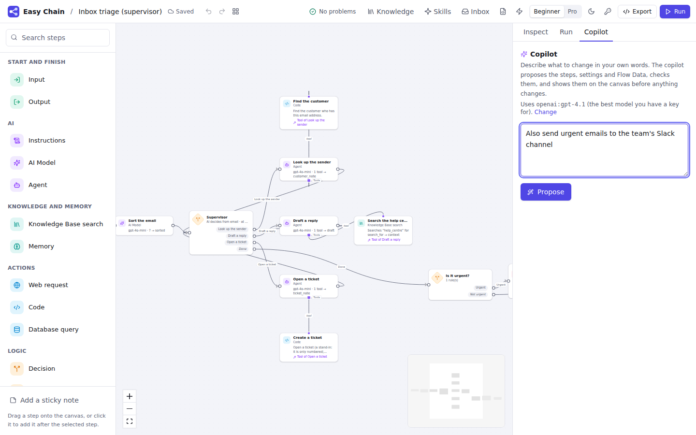

# Phase 4: report

**Status: Phase 4 (Autopilot and teams) meets its "Done when".** Work stops here for review
before Phase 5, as the build prompt asks.

The Phase 3 report's questions were answered "OK go on" to the recommendations
([decisions 4.1–4.3](../handover/decisions.md#phase-4-answers-to-the-phase-3-reports-questions)):

- the "Done when" below;
- Code steps run in **Docker**, with **gVisor** where it is installed, and this works with Docker
  Desktop on Windows too;
- the copilot uses **any model you have a key for**; with no key, the stand-in shows an example.

Build decisions taken along the way are decisions 4.4–4.10 in the same file.

## Done when

| Done when | Evidence |
|---|---|
| A **Research assistant** template (Deep Agent + Helpers + to-do list + files) passes a 10-case Test Set | **10/10.** `python/src/easychain/templates/research-assistant.tests.yaml` runs in `tests/test_templates.py` and with `easychain test`. The cases cover: <ul><li>the lead plans, the researcher reads the page, the report has numbered sources, and the reviewer checks it;</li><li>two pages, each with its own source number;</li><li>the researcher's reply comes from the page it really read;</li><li>the reviewer finds an unsupported fact and the lead removes it (`edit_file`);</li><li>a part the pages don't answer is said, not guessed;</li><li>the lead reads its *research-report* skill;</li><li>notes kept in their own file;</li><li>a page that can't be read is reported, and the run still finishes;</li><li>a side task goes to the general helper;</li><li>**with no script at all**, the stand-in plans, reads the skill, hands the reading to the researcher (who reads the page) and writes the report.</li></ul> `tests/test_research_assistant.py` also runs the **exported** project on its own, skills included. |
| **Code steps can't escape their sandbox** | `tests/test_sandbox.py` runs real containers and tries to break out. Each attempt fails with a plain message: <ul><li>reading the host's files;</li><li>opening network connections;</li><li>reading Easy Chain's environment and secrets;</li><li>becoming root or using capabilities;</li><li>reaching the Docker socket;</li><li>writing outside `/tmp`;</li><li>a fork bomb;</li><li>using too much memory;</li><li>running past the time limit.</li></ul> CI runs these on Linux, and the Compose job checks that a Code step really runs in a container. |
| (also checked in the browser) | Playwright journeys run against the real app and the fake model server: the Research assistant (Helpers on the canvas, the trace with each Helper's work nested under its task, the to-do list, the files), the Skills library, Inbox triage (a supervisor and an Inbox pause), the sandbox settings, and the copilot. Each has axe WCAG 2.2 AA scans. |

**Inbox triage**, the other Phase 4 template, also passes **10/10**. Like Phase 3's, the Test
Sets **script** the model's turns, so they are deterministic and need no key. The pages, files,
skills, Helpers, routes, round limits and Inbox pauses are real.

## What was built

**4.1 Code sandbox** ([docs/sandbox.md](../sandbox.md))

- Each Code step call, and each Code tool an agent uses, runs in a fresh Docker container:
  - no network unless the step asks for it;
  - a read-only file system without the host's files;
  - none of Easy Chain's environment or secrets;
  - an unprivileged user with no capabilities;
  - limits on memory, CPU, processes and time.
- gVisor (`runsc`) is used automatically when Docker has it.
- **Settings → Sandbox** shows whether Docker was found, has the mode (*use Docker when it's
  there*, *always*, *off*) and the limits, and prepares the image. The check before a run says
  when Code steps would run without a sandbox.
- A step's packages are built into a cached image. Errors come back as the code raised them, and
  "run at most once" works inside the sandbox.
- `docker-compose.sandbox.yml` is an opt-in overlay that gives the worker Docker. Exported code
  runs Code steps in its own process and says so.

**4.2 Deep Agent** ([step page](../steps/deep_agent.md))

- Built on `deepagents.create_deep_agent`. It plans with a to-do list, keeps files, follows
  skills and hands sub-tasks to Helpers. It has everything an Agent has: tools, MCP tools,
  Add-ons and an answer format.
- **Files** live in the agent's checkpointed state and in a Flow Data field (decision 4.4). They
  come back in the next turn of a chat, survive a killed worker (SQLite and Postgres), and
  rewind with time travel.
- There is no shell (decision 4.5).
- Approvals can name the agent's own tools (`write_file`, `task`, …) and go through the Inbox.
- The run panel shows the to-do list and each file as they change (`todos` and `files` events).

**4.3 Helpers** ([step page](../steps/helper.md))

- Specialists under a Deep Agent, each with its own role, model, tools and skills. On the canvas
  they connect to the Deep Agent's **Helpers** handle.
- In the trace, a Helper's tool calls nest under the task that started it. The task carries the
  Helper's tokens, cost and model, and the step's total includes them.
- A Helper's approval pauses the whole run. The *general helper* that deepagents adds gets the
  Deep Agent's tools, approvals and limits, so it can't be used to get round them.

**4.4 Skills** ([docs/skills.md](../skills.md))

- A Skills library in the Agent Skills format: a folder with a `SKILL.md` (name and description)
  and the files it points to.
- The workspace's `skills/` folder sits over the built-in skills, *research-report* and
  *source-notes*. A copy replaces a built-in skill, and deleting the copy brings the built-in one
  back.
- A **Skills page** to browse, edit and create skills. Skills are checked before they are saved,
  and a step that names a missing skill has a problem with a fix.
- A Deep Agent or Helper sees its skills' descriptions and reads a skill when it fits the task.
  The skills are built into the generated code, so exports have them (decision 4.6).

**4.5 Agent team patterns** ([docs/patterns.md](../patterns.md))

- **Supervisor**, **handoffs** and **plan-and-execute** as templates made of ordinary steps
  (decision 4.7), each with a 10-case Test Set. The step library inserts any of them into the
  open flow.
- Two small changes made them work:
  - an AI Decision's guidance takes `{field}` placeholders;
  - in a chat, a field a later step sets counts as set, because it carries over from the last
    turn.
- Each exported pattern runs on its own.

**4.6 Describe-it copilot** ([docs/copilot.md](../copilot.md))

- **How it proposes:**
  - In the **Copilot** tab you describe a flow, or a change to the open one.
  - The model writes the whole flow as YAML, with a summary and Test Set cases.
  - Easy Chain reads it with the flow spec and runs the checks. Errors go back to the model,
    twice at most, so only a proposal with no errors is shown (decision 4.8).
- **How you review it:**
  - The proposal becomes separate changes with plain labels.
  - The canvas previews the changes you keep, with new and changed steps marked and editing
    paused.
  - **Apply** is one undo step. Kept test cases go into the flow's Test Set.
- **Placing new steps:** a new step goes right of the step that leads into it, and an agent's
  new tool goes under the agent. Later steps move right to make room, and no step lands on
  another.
- Problems that have no fix of their own get **Ask the copilot** (decision 4.9).
- With no key, the stand-in shows the closest template as a proposal.

**4.7 Templates**

- **Research assistant**: a Deep Agent (*Research lead*) with two Helpers.
  - The **researcher** reads the pages it is given with a Web request tool and follows
    *source-notes*.
  - The **reviewer** checks the report against the notes.
  - The lead follows *research-report*, keeps `/notes.md` and `/report.md`, and saves its plan.
- **Inbox triage**: a supervisor.
  - An AI Model sorts the email into a topic, an urgency and a one-line summary, as Flow Data.
  - Helpers look up the sender, draft a reply from the help centre (a Knowledge Base search
    tool) and open a ticket (run at most once).
  - An urgent email waits in the Inbox for a person to check the reply.

**Along the way**

- **The stand-in AI** plays a Deep Agent sensibly with no script. It plans, reads the skill that
  fits, hands the task to the best Helper and writes the file its instructions ask for. A tool
  that takes a web address now reads each address the request names, in order.
- **CI:** the end-to-end job runs on Ubuntu 24.04, because Playwright has no browser for 26.04
  yet. The Windows crash test waits longer for its worker.
- **Version 0.4.0** (decision 4.10).

## Screens

| | |
|---|---|
|  |  |
|  | |

## Demo script (about 10 minutes)

1. **Start it up.** Run `pnpm dev` or `docker compose up`. For Code steps in containers with
   Compose, add `-f docker-compose.sandbox.yml`. Then open **Settings → Sandbox**: it says
   whether Docker was found. Press **Prepare the sandbox**.
2. **Research assistant:**
   1. **Use template → Research assistant**. The Researcher and Reviewer hang under the
      Research lead, and *Read a page* is the Researcher's tool.
   2. Click the lead and look at its **Helpers** and **Skills** (*research-report*).
   3. Open **Run**. Ask a question and paste two page addresses, one per line. With no key,
      switch on the stand-in AI.
   4. In **Steps**, open the Research lead:
      - its **to-do list**;
      - **Helper researcher** with the `read_page` calls it made under it;
      - the **files**: `/report.md`, and `/notes.md` with a real model.
3. **Skills:**
   1. Open **Skills**, then *research-report* and its `outline.md`.
   2. Press **New skill**, write a short *tone-of-voice* skill, and save it.
   3. Back on the Research lead, add it under **Skills**.
4. **Inbox triage:**
   1. **Use template → Inbox triage**, then run the sample email (a double charge, to sort out
      today).
   2. The supervisor hands the email to the helpers in turn.
   3. Because it is urgent, the run waits in the **Inbox**. Edit the reply and **Approve**.
5. **Copilot:**
   1. On a new flow, open the **Copilot** tab and describe *"Summarise a web page in three
      bullet points"*. With a key, your model writes it; without one, the stand-in shows the
      closest template.
   2. Untick a change and watch the canvas update. **Apply**, then **Undo** once: the whole
      proposal goes.
   3. On a flow with a problem that has no fix button, press **Ask the copilot**.
6. **Agent team patterns:** in the step library under **Agent team patterns**, click
   *Supervisor*. Its steps are added below the flow, with their Flow Data.
7. **Sandbox:** with an OpenAI key set, add a Code step (with `import os`) that returns
   `{"key": os.environ.get("OPENAI_API_KEY"), "ssh": os.path.exists(os.path.expanduser("~/.ssh"))}`,
   and run it. It returns `null` and `false`: the container has neither your keys nor your files.
   A Code step that calls `urllib.request.urlopen("https://example.com")` fails with `URLError`
   until **Let it use the internet** (Pro) is on.
8. **Export** the Research assistant and run it on its own: `pip install -r requirements.txt`,
   then `python research_assistant.py '{"request": "…"}'`. The skills are inside.

## Known gaps and risks

- **Sandbox:**
  - It needs Docker. Without Docker, Code steps run in-process with a warning on the step,
    unless the sandbox is set to *Always*.
  - Every call starts a container, which adds start-up time. A warm pool, microVMs and hosted
    sandboxes (E2B, Modal) can sit behind the same proxy later.
  - In Compose, the worker gets the host's Docker socket, which is powerful. That is why it is an
    opt-in overlay.
  - Exported code runs Code steps in its own process.
- **deepagents moves quickly.** It is pinned exactly (0.7.22), and golden files pin the
  generated code.
- **Deep Agent files are kept in the run's state.** Very large files make every Save Point
  bigger. A store-backed `/memories/` area for long-term files can come with long-term memory
  for Deep Agents.
- **Helpers that run side by side** (when the lead hands out several tasks at once) take their
  turns in no fixed order, so Test Sets script one task at a time. A Helper's own tokens are not
  streamed into the answer; its reply arrives as the task's result.
- **Skills are instructions and files.** Scripts inside a skill are not run, because there is no
  shell (decision 4.5). Code belongs in Code steps.
- **Copilot:**
  - Its quality depends on the model. It is tested in CI with scripted replies, not real models.
  - It sends the whole open flow each time, so very large flows make long prompts.
  - The stand-in copilot only shows templates, and it can't fix problems.
- **Real models are not run in CI** (no keys, by design). Before a release, run the agent
  templates' Test Sets with a real model (`easychain test --real-model`).
- **The Research assistant has no web search.** It reads the pages you give it. A search API or
  MCP tool can be added as one of the researcher's tools.
- **Inbox triage's customer lookup and ticket** are Code stand-ins, to replace with your CRM's and
  helpdesk's APIs (Web request steps or Import an API).
- **Fetching on the server** (pages, OpenAPI documents, Web request tools) still needs an egress
  allow-list for a shared deployment. It is planned for Phase 5, with roles.

## Phase 5 plan: Platform

The plan is in [ROADMAP.md](../ROADMAP.md#phase-5-platform).

**Proposed "Done when":**

1. A flow moves **draft → staging → production** only when its Test Run passes in CI.
2. A published flow serves an API endpoint and a chat widget, with per-key rate limits.
3. Roles stop a Viewer from editing and an Editor from publishing to production.
4. Every change and publish is in the audit log.

**Order:**

1. Migrations (Alembic) first, then users, roles, SSO and the audit log, with the egress
   allow-list.
2. The Test Sets editor and Checks, Test Runs and baselines, then `easychain eval` as a CI gate.
3. Environments and Publish, then the model gateway (budgets, caching, fallbacks).
4. Dashboards and tracing (OpenTelemetry, LangSmith).

This phase turns a single-user tool into a multi-user server, so each milestone includes its
own security review.

## Questions for you

1. **Phase 5 "Done when":** are the four criteria above right?
2. **Single sign-on:** CI will test against a local identity provider. Which real provider
   should the final check use: Okta, Google, Microsoft Entra, or none for now?
   *Recommended:* none for now, with the setup documented for all three.
3. **Publish:** should publishing be self-hosted only, or also include a managed cloud?
   - Self-hosted means your Easy Chain server serves the API, the chat page and the widget, and
     `easychain deploy` builds an image or a Compose bundle.
   - *Recommended:* self-hosted only in Phase 5.
4. **LLM-as-judge checks:** which model should judge?
   *Recommended:* the copilot's rule, meaning any model you have a key for. With no key, judge
   checks are skipped, with a note, rather than faked.
5. **Real-model checks before a release:** how should they run?
   - You run `easychain test --real-model` with your key, or
   - a manual CI workflow uses a budgeted key stored as a repository secret.

   *Recommended:* the manual workflow, so the result is recorded.
