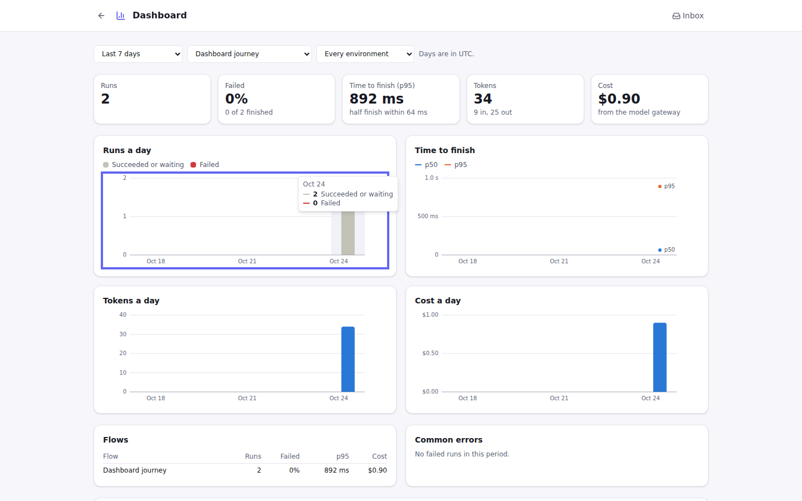

# Phase 5: report

**Status: Phase 5 (Platform) meets its "Done when".** Work stops here for review before
Phase 6, as the build prompt asks.

The Phase 4 report's questions were answered "report looks fine so lets get on" to the
recommendations ([decisions 5.1–5.6](../handover/decisions.md#phase-5-answers-to-the-phase-4-reports-questions)):

- the four "Done when" criteria below;
- single sign-on tested against a local identity provider, with setup written for Okta, Google
  and Microsoft Entra;
- self-hosted publishing only;
- the AI judge uses any model with a key, and is skipped (never faked) without one;
- real-model checks run in a manual CI workflow with keys stored as repository secrets;
- every step marked in the README's **build tracker**, with a **Fix later** list.

Build decisions taken along the way are decisions 5.7–5.22 in the same file. The milestones
were built in the planned order: 5.8, 5.6, 5.1, 5.2, 5.3, 5.4, 5.5, 5.7. The version is now
**0.5.0** (decision 5.22).

## Done when

| Done when | Evidence |
|---|---|
| A flow moves **draft → staging → production** only when its Test Run passes in CI | `tests/test_publish.py::test_a_version_moves_to_staging_and_production_only_when_its_test_run_passes`: <ul><li>Staging is refused (409, "needs a kept Test Run of this version, run in Staging") until a Test Run of *that version*, run *in Staging*, passes every case. A passing run outside Staging doesn't count, and a failing one keeps the version out.</li><li>Production takes only the version that is in Staging.</li><li>A changed flow is a new version and can't skip Staging.</li></ul> From CI, `easychain publish --to staging` runs the Test Set on the server and publishes only if every case passes; otherwise it lists the failures and exits with 1 (`test_publish_from_ci_runs_the_test_run_first`). `easychain eval` fails a CI job on a regression against the baseline in git (`tests/test_evaluate.py`). Easy Chain's own CI gates eight templates with the GitHub Action (the **Flows** job). |
| A published flow serves an **API endpoint and a chat widget**, with per-key rate limits | <ul><li>`test_other_apps_run_a_published_flow_with_its_access_key`: `POST /api/published/{flow}/{env}` runs the published version with that environment's secrets. A key is refused for another environment, after it is revoked, and when nothing is published. Past its limit a minute, a key gets `429` with `Retry-After`; the limit is counted in the database, so every API server shares it.</li><li>`test_people_chat_with_a_published_flow`: the chat page (with `frame-ancestors` for the listed sites), the widget script, and a conversation that remembers.</li><li>The `e2e/publish.spec.ts` journey publishes a chat flow, makes a chat link and chats on its page.</li></ul> |
| **Roles** stop a Viewer from editing and an Editor from publishing to production | <ul><li>`tests/test_auth.py::test_every_route_says_who_may_use_it` fails for any route without a declared least role; an undeclared route is closed.</li><li>`test_each_role_gets_what_it_should_and_no_more`: a Viewer can't save, run or change anything.</li><li>`tests/test_publish.py::test_only_an_owner_publishes_to_production`: an Editor publishes to Development and Staging, but gets 403 for Production and for Production keys; an Owner can.</li><li>In the browser, `e2e/auth.spec.ts` signs in as each role: a Viewer gets a view-only editor, a Runner runs and answers the Inbox, and an Editor sees settings it can't change.</li></ul> |
| **Every change and publish** is in the audit log | <ul><li>`tests/test_audit.py::test_every_change_is_recorded_or_says_why_not` fails for any changing route that is in neither `AUDITED` nor `NOT_AUDITED` (with its reason).</li><li>Publish, unpublish and keys are recorded (`flow.publish`, `flow.unpublish`, `flow.key_create`, `flow.key_revoke`), and so are environment, gateway and tracing changes.</li><li>Database triggers refuse to change or delete entries, on SQLite and Postgres (`test_nothing_in_the_log_can_be_changed_or_removed*`).</li></ul> |

**Tests at the end of Phase 5:**

| Suite | Passing |
|---|---|
| Python, Linux (with Postgres and pgvector, and Docker for the sandbox) | 646 |
| Python, Windows (CI) | all |
| Web unit | 114 |
| Client package | 14 |
| Playwright journeys | 47 |
| Template Test Sets | 13 of 13 |
| CI gate (`easychain eval`, eight templates against their baselines) | all |

## What was built

**5.8 Platform groundwork**

- **Database migrations** with Alembic (`server/migrations/`, 0001–0009):
  - every process upgrades the database when it starts, under a lock;
  - a database made by 0.4.0 or earlier is stamped at the baseline;
  - a newer database is refused;
  - `easychain db status` / `upgrade`.
- **Knowledge Base documents are read by workers** from the job queue. Uploaded files wait in
  the database, so workers need no shared disk.
- **Postgres LISTEN/NOTIFY** wakes other processes in about 2 ms; SQLite still polls.

**5.6 Users, roles, single sign-on, audit, workspaces** ([people](../people.md),
[audit](../audit.md), [sso](../sso.md), [network](../network.md), [workspaces](../workspaces.md))

- **Sign-in:**
  - local accounts; on by default when the server answers the network, and off on this
    computer;
  - the first Owner needs a code from the server's log;
  - **keys for scripts** act as their person, capped at a role.
- **Roles** Owner, Editor, Runner and Viewer, on every endpoint. The web app adapts to each
  role.
- **The audit log**: every change, with who, when and what. It is append-only in the database.
- **Single sign-on** with OpenID Connect and PKCE, tested against a local test provider.
- **The egress allow-list** for fetches the server makes (open, public, or an allow-list),
  checked again at connect time.
- **Workspaces.** Each workspace keeps its own:
  - flows, runs and Inbox;
  - triggers and Knowledge Bases;
  - skills and settings;
  - secrets vault and long-term memory;
  - people and audit log.

  Secrets reach a run through a per-run layer over `os.environ`.

**5.1 Test Sets and Checks** ([testing](../testing.md))

- The **Tests** tab edits and runs a flow's Test Set (still a YAML file next to the flow).
- Checks:
  - values and JSON schema;
  - the steps and route taken;
  - tool calls, and their order (trajectory);
  - time, token and cost budgets;
  - an **AI judge** with a rubric.

  Each check passes, fails with a reason, or is skipped with why.

**5.2 Test Runs and baselines**

- A kept Test Run runs on a worker against the saved version. Each case runs 1–10 times,
  which gives a pass rate and shows flaky cases.
- Each run is compared with the flow's **baseline**: better, worse or the same per case, with
  changes in time and cost.
- `.github/workflows/real-models.yml` runs the templates with real models, by hand, before a
  release.

**5.3 The CI gate** ([ci](../ci.md))

- `easychain eval` compares a run with a baseline file in git. Only a **regression** fails it.
  It also has time, cost and budget limits, a Markdown summary and JSON output.
- A GitHub Action (`.github/actions/easychain-eval`), and a guide for other CI systems.

**5.4 Environments and Publish** ([publish](../publish.md))

- **Environments.** Development, Staging and Production, each with:
  - secrets over the workspace's;
  - model swaps;
  - Knowledge Base swaps.
- **Promotion** through a passing Test Run in Staging. Only an Owner publishes to Production.
- **Publish** pins a version and gives it:
  - an API endpoint, with access keys;
  - a hosted chat page and a widget, with chat links.

  Both are limited per minute.
- `easychain publish` for CI. `easychain deploy` makes a Compose bundle or a Docker image.

**5.5 The model gateway** ([gateway](../gateway.md))

- **Every model call is recorded** with its tokens and cost: runs, Test Runs, the Tests tab, the
  AI judge and the copilot.
- **Spending** per flow, person, environment, model and run.
- **Budgets** for the workspace, drafts and each environment, a day or a month. They alert
  through Notifications and can stop model calls.
- **Cached answers** for drafts and chosen environments.
- **Fallbacks** to other models when a provider fails; **retries**; **smoothing**.
- **Your own prices** for any model.

**5.7 Dashboards and tracing** ([dashboard](../dashboard.md), [tracing](../tracing.md))

- **The Dashboard** shows, per UTC day over 7, 30 or 90 days, for the workspace, a flow or an
  environment:
  - runs and failures;
  - time to finish (p50 and p95);
  - tokens and cost.

  It also lists the flows and the commonest errors. Every chart can be read with the keyboard,
  and there is a table of each day.
- **OpenTelemetry.** Each run is one trace (across pauses too), with spans for the run, each
  step, tool call and model call, and the GenAI attributes. It is sent over OTLP/HTTP after
  each part of the run. **Send a test span** checks the collector.
- **LangSmith**, with the workspace's own key and project.

## Screens

## Demo script (about 15 minutes)

1. **Start it up** with `docker compose up` (sign-in is on) or `pnpm dev` (on this computer,
   sign-in is off). With Compose:
   1. Make the first Owner with the code from `docker compose logs easychain`.
   2. **Settings → People**: add an Editor and a Viewer.
2. **Roles.** Sign in as the Viewer in a private window. The editor is view-only, and
   Settings shows only what a Viewer may see.
3. **Test Sets.** Use the **Support bot** template:
   1. Open **Tests**. Add a case with a *contains* check and a judge rubric, then **Run all**.
      Each check says why it passed, failed or was skipped. (The judge is skipped with the
      stand-in AI.)
   2. Under **Kept Test Runs**, press **Run and keep** with *Repeat 3*, and make it the
      baseline.
   3. Change the Instructions and run again: the comparison shows which cases got better or
      worse.
4. **CI gate.** Run `easychain eval python/src/easychain/templates/support-bot.tests.yaml
   --stand-in`. It passes against the baseline in git. Break a case on purpose and it exits
   with 1 and lists the regression.
5. **Publish:**
   1. Press **Publish**, then **Publish to Development**.
   2. **Publish to Staging** is refused until a Test Run *in Staging* passes. Run one from
      Tests (**Run in: Staging**), then publish.
   3. As the Editor, **Publish what's in Staging** to Production is refused. As the Owner, it
      works.
   4. Under **Access**, make an access key and call the endpoint with `curl`
      ([publish.md](../publish.md)).
   5. Make a chat link and open its chat page.
6. **Environments.** In **Settings → Environments**, swap `openai:gpt-4.1` for
   `openai:gpt-4.1-mini` in Development, and set a Production-only secret.
7. **Model gateway:**
   1. In **Settings → Model gateway**, set a Drafts budget of $0.01 a day that stops calls.
   2. Run a flow with a real model twice. The second run stops with *"The Drafts budget is
      used up"*, and its button opens these settings.
   3. Turn on caching for Drafts and run the same question twice. The second answer is free.
   4. The spending table shows the cost per flow, person and model.
8. **Dashboard.** Open **Dashboard** on the home page. Filter by flow and environment, and
   use the arrow keys on a chart to read each day.
9. **Tracing:**
   1. Start Jaeger: `docker run -p 16686:16686 -p 4318:4318 jaegertracing/all-in-one`.
   2. In **Settings → Tracing**, set `http://localhost:4318`, then **Send a test span**.
   3. Run a flow and open it in Jaeger (localhost:16686): the run, its steps and its model
      calls.
   4. For LangSmith, add `LANGSMITH_API_KEY` as a secret and turn it on.
10. **Audit.** **Settings → Audit log** lists everything above, with who did it.

## Known gaps and risks

Each one is in the README's **Fix later** table, with where it will be handled.

- **Real models in CI.** The real-model workflow exists but hasn't been run yet. It needs API
  keys stored as repository secrets, with a spending limit (F33).
- **Shared servers:**
  - Without the sandbox, a Code step runs in the server's process and could read another
    workspace's files. Set the sandbox to *required* outside the default workspace (F30).
  - Wrong-password counts are kept per process (F25).
  - The egress policy doesn't cover model, notification or tracing addresses (F28).
- **Publishing:**
  - Behind a proxy, a chat link's per-visitor limit counts the proxy's address (F35).
  - The chat page shows plain text (F36).
  - `easychain deploy` builds on an image you build yourself; no image is published yet (F37).
- **Model gateway:**
  - Smoothing is per process (F38).
  - Budgets can go over by calls already under way (F39).
  - `model_calls` keeps every row (F40).
  - Embedding calls aren't metered (F41).
  - The cache is exact, not semantic (F42).
- **Dashboards and tracing:**
  - OpenTelemetry is OTLP/HTTP only, and spans leave when each part of a run ends (F43).
  - The dashboard adds up the period's runs in the server; very busy workspaces will need
    daily totals in the database (F44).
- **Workspaces** can't be deleted yet (F29).
- **Dependencies.** OpenTelemetry's SDK and OTLP exporter are new and pinned. LangGraph,
  LangChain and deepagents are still pinned exactly, and golden files catch changes.

## Phase 6 plan: Ecosystem

The plan is in [ROADMAP.md](../ROADMAP.md#phase-6-ecosystem).

**Proposed "Done when":**

1. The exported **LangGraph.js** project passes the same Test Set as the Python export, for
   every template.
2. A custom step published to the registry installs into another workspace and runs.
3. Two people edit the same flow at once without losing changes.
4. The Helm chart deploys to a local Kubernetes (kind) cluster and passes the smoke test.

**Proposed order:**

1. **6.6 Helm chart** and published images first. They are small, and they close F37.
2. **6.1 LangGraph.js export.** This is the largest new surface, so it starts early.
3. **6.2 Custom step registry**, then **6.3 Import**.
4. **6.5 Prompt optimisation**, built on Test Runs.
5. **6.4 Real-time collaboration** last, because it changes how the editor saves.

## Questions for you

My recommendation is in *italics*.

1. **Phase 6 "Done when":** are the four criteria above right?
2. **Order:** is the order above right? *Yes: Helm and images first, collaboration last.*
3. **Published images:** where should release images go? *GitHub Container Registry
   (`ghcr.io/shubham-wiz/easychain`), built by CI on each version tag.*
4. **Real-model check:** can you add `OPENAI_API_KEY` (and `ANTHROPIC_API_KEY` if you use it)
   as repository secrets, with a spending limit on the key, so the real-model workflow can run
   once before the next release? *Yes, with a $5 limit.*
5. **Keeping model-call records:** how long? *A year by default, as a setting; older rows are
   rolled up into daily totals that the dashboard can read (F40, F44).*

Reply "go on" to accept the recommendations, or change any of them.
