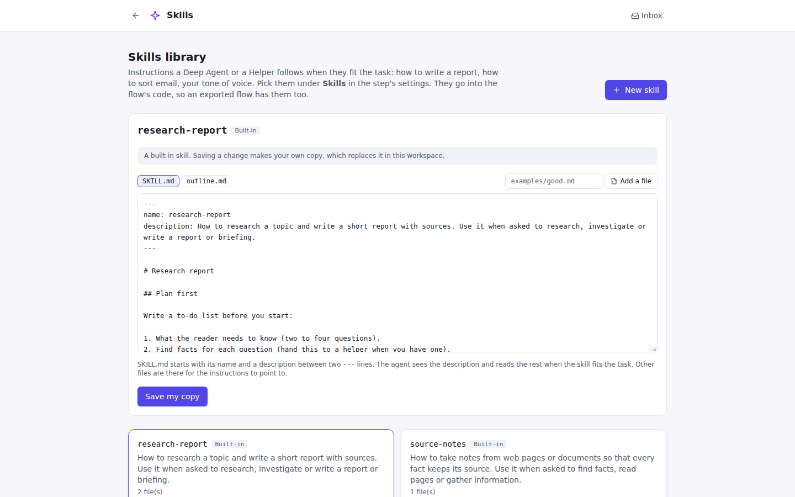

# Skills

A **skill** is a set of instructions a [Deep Agent](steps/deep_agent.md) or a
[Helper](steps/helper.md) follows when it fits the task: how to write a report, how to sort
incoming email, your tone of voice, the steps of a review. Skills use the
[Agent Skills](https://agentskills.io) format, so a skill written for another agent tool works
here too.



## What a skill is

A folder with a `SKILL.md` and, if it needs them, other files its instructions point to:

```
report-writing/
├── SKILL.md
└── outline.md
```

`SKILL.md` starts with front matter: the skill's **name** (lowercase letters, digits and
dashes, like the folder) and a **description** of what it is for and when to use it.

```markdown
---
name: report-writing
description: How to write a short report with sources. Use it when asked for a report or a briefing.
---

# Report writing

1. Plan the sections first…
```

An agent sees every skill's name and description. When a description matches the task, it reads
that skill's `SKILL.md` (and the files it points to) and follows it. A skill it doesn't need
costs it only a line of its instructions.

## The Skills library

Open **Skills** at the top of the app. It lists:

- **your workspace's skills**, saved as folders in the workspace's `skills/` folder
  (`<workspace>/skills/<name>/SKILL.md`), so they can go in git with the flows;
- **built-in skills** that come with Easy Chain: `research-report` and `source-notes`.
  Saving a change to a built-in skill makes your own copy, which replaces it in this workspace;
  **Go back to the built-in one** deletes your copy.

**New skill** starts one from a short example. Edit `SKILL.md`, add other files with **Add a
file**, and **Save the skill**. Easy Chain checks the front matter and says what to change if
the skill can't be used.

## Using a skill

Pick skills under **Skills** in a Deep Agent's or a Helper's settings. The check before a run
says when a skill is missing from the library, with a fix that takes it off.

The skills go into the flow's generated code, under `/skills/<step>/<skill>/` in the agent's
files, so:

- an **exported** flow has its skills and runs without Easy Chain;
- changing a skill in the library changes the code the next time the flow runs (the compiled
  code is cached until a skill changes);
- the skills stay out of the files a Deep Agent saves to Flow Data.

`easychain run`, `test` and `export` look for skills next to the flow file, in `skills/`, and
in the built-in skills.

## Without an API key

The [stand-in AI](agents.md#testing-agents) reads the skill whose description shares the most
words with the task, and writes the file a skill (or the instructions) asks for, so a Deep Agent
with skills does something sensible before you add a key. Test Sets can script the turns
instead, for example `{call: read_file, args: {file_path: /skills/lead/report-writing/SKILL.md}}`.

## The API

| Method | Path | What it does |
|---|---|---|
| GET | `/api/skills` | Every skill: name, description, files, `built_in`, `replaces_built_in` |
| GET | `/api/skills/{name}` | One skill with its files' text |
| PUT | `/api/skills/{name}` | Save a workspace skill: `{"files": {"SKILL.md": "…", "outline.md": "…"}}` (422 with a message when it isn't valid) |
| DELETE | `/api/skills/{name}` | Delete a workspace skill (built-in skills stay) |
